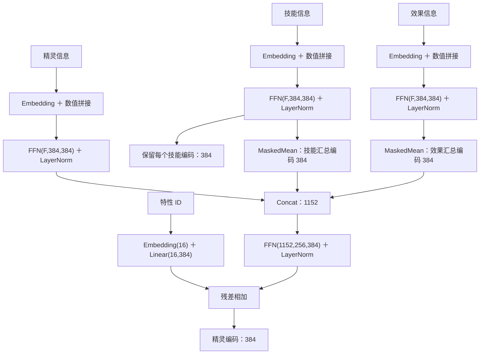
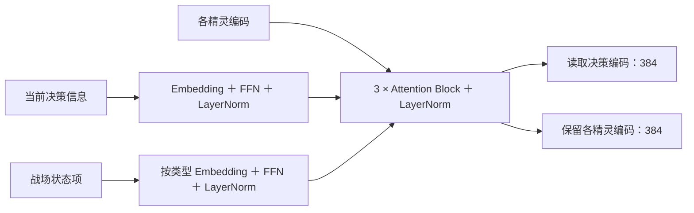
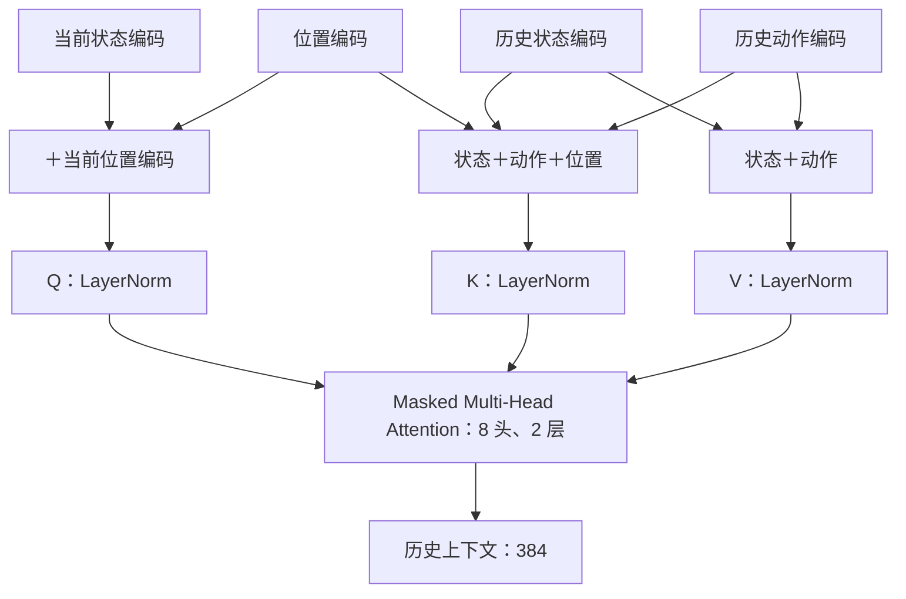
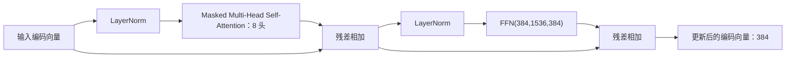
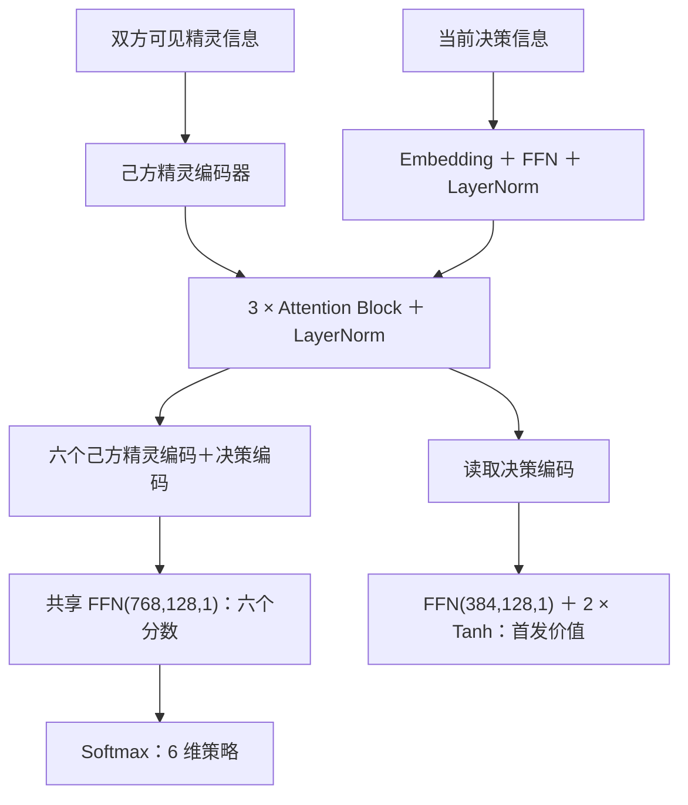
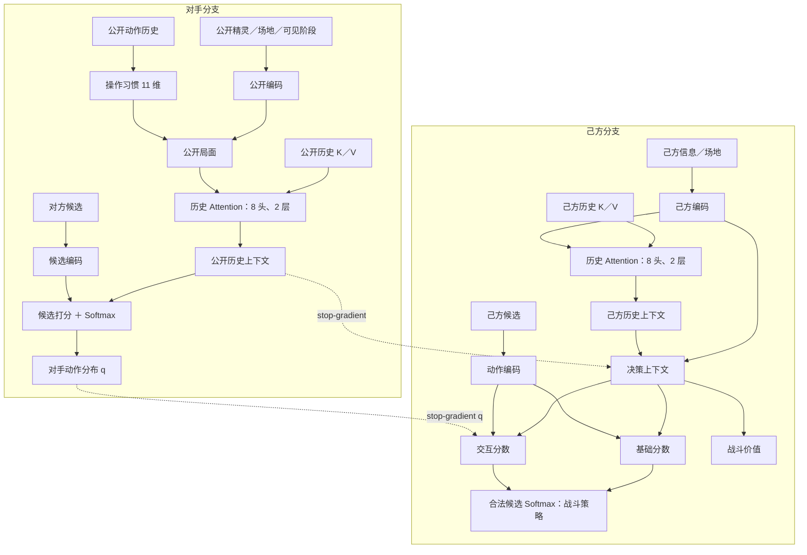

# Alpha Roco 模型设计

## 1. 网络结构

### 1.1 基本配置

#### 1.1.1 输入

| 来源 | 内容 |
|---|---|
| 己方 | 六只精灵的完整属性、技能、特性、性格、能量、效果、出战位与可见数值 |
| 公共 | 双方身份与公开种族资料、生命百分比、已揭示技能、可见 buff／debuff、印记、天气、公开行动与特性触发 |
| 候选 | 己方合法动作及派生特征；对方候选及公开派生特征 |
| 历史 | 每个决策的状态编码、动作编码与位置编码；己方历史与公开历史分开保存 |

- 数值归一化，未知值使用占位符，缺失项由 mask 屏蔽。
- 派生特征包括属性克制倍率、本系加成、预计伤害占比、预计击杀回合、速度先后、能量是否足够与技能静态属性。
- 特性 ID 双方可见，作为独立输入。
- 对手预测分支只读取公共信息与公开动作历史。

#### 1.1.2 超参数

- 隐藏维度 `384`；当前局面 Attention 为 `8` 头、`3` 层，FFN 隐藏维度为 `4 × 384`；历史 Attention 为 `8` 头、`2` 层。
- 身份／类别／特性 Embedding 为 `32／16／16` 维；阶段／顺序编码为 `384` 维；操作习惯编码为 `11` 维。
- Attention 残差与 FFN 输出使用 dropout，比例 `0.1`；采样与推理关闭，更新时开启。

#### 1.1.3 可学习参数

- Embedding 表、Linear／Attention 权重与偏置、LayerNorm 缩放与偏移。
- 首发与战斗共享己方编码器；对手分支使用独立参数。

#### 1.1.4 环境

- 设备：RTX 4080 SUPER（16 GB）。
- 单次决策上限：`20` 秒。

### 1.2 输入信息与编码器

记号：`FFN(a,b,c) = Linear(a,b) → GELU → Linear(b,c)`；`F` 为输入维度；`MaskedMean` 对有效项求平均。

#### 1.2.1 精灵、技能与效果编码

- 精灵信息：身份、类别、主属性、副属性、性格、特性 ID、数值或区间、mask。
- 技能信息：身份、类别、属性、威力、能耗、应对类别、打断、传动、迅捷、蓄力、可用、明暗、mask。
- 效果信息：类型、数值、duration、mask。

- 主属性与副属性分别编码；己方性格使用独立 Embedding；对方不可见数值按个体值与性格范围推算为区间。
- 特性 ID 经独立投影后以残差方式加入精灵编码。

#### 1.2.2 战场状态与决策编码

| 输入 | 编码内容 |
|---|---|
| 当前决策信息 | 决策类型、阶段、时序位置与参与方 |
| 精灵信息 | 身份、类别、主副属性、性格、特性 ID、数值或区间、技能与效果 |
| 战场状态项 | 状态类型、所属方、数值与 mask |

#### 1.2.3 历史记录编码

- 每个决策保存历史 K 和历史 V：
  $$
  K_i=\operatorname{LayerNorm}(s_i+a_i+p_i),\qquad
  V_i=\operatorname{LayerNorm}(s_i+a_i)
  $$
  其中 $s_i$ 为状态编码，$a_i$ 为动作编码，$p_i$ 为位置编码。
- 当前决策状态加当前位置编码作为 query；全部历史 K／V 参与 attention；使用 causal mask 与 padding mask；历史不截断。
- 己方历史与公开历史分别使用独立的历史 Attention；训练和推理使用同一顺序。

### 1.3 Attention Block

首发、己方战斗局面、对手公开局面各使用 `3` 个下列 Block，输出接 LayerNorm；各分支参数独立。

### 1.4 首发模块

### 1.5 战斗模块

战斗模块包含三条信息流：

1. **己方局面与历史**：己方可见信息经过 `1.2` 编码与 `3` 层 Attention，得到当前局面；己方历史 K／V 经过 `2` 层历史 Attention，得到己方历史上下文。
2. **对手预测**：只读公开信息、公开历史 K／V 与操作习惯。操作习惯由历史公开动作汇总为 `11` 维：动作总数、技能／换人／聚能／其他频率、最近 `8` 次动作中的技能／换人／聚能频率、技能多样性、共鸣使用率、明暗分支 `1` 选择率。习惯经零初始化 `Linear(11,384)` 残差加入公开局面；公开历史 Attention 输出对手上下文；对手候选编码后得到下一步动作分布 $q$。
3. **己方决策**：当前局面、己方历史上下文与 stop-gradient 的公开历史上下文组成决策上下文。己方候选动作单独编码，基础分数由决策上下文与候选动作计算；交互分数由决策上下文、己方动作、对方动作计算，并按 $q$ 加权。基础分数与交互分数相加后对合法候选做 Softmax。

技能候选携带动作类别、精灵、技能、明暗分支、威力、能耗、使用后能量、是否可支付、属性克制倍率、本系加成、预计伤害占比、预计击杀回合、速度先后、应对类别、打断、传动、迅捷、蓄力与可用标记；换人候选额外携带入场精灵的攻防克制关系。对方候选使用同一套候选编码。

## 2. 奖励

奖励只记录 candidate A 侧；B 侧不计算奖励。奖励由终局、势能、行为先验和探索四部分组成。

### 2.1 终局

- 获胜 `+1`，失败 `-1`，`both_lose` 双方 `-1`。
- 首发决策和最后一个战斗决策都使用终局收益。

### 2.2 势能

战斗决策使用势能差：

$$
\Phi(s)=0.5\left(H_{\text{对方}}-H_{\text{己方}}\right)
+0.1\frac{N_{\text{对方}}-N_{\text{己方}}}{6}
+0.02E,
\qquad
r_t=\gamma\Phi(s_{t+1})-\Phi(s_t)
$$

- $H$ 为队伍平均剩余生命比例；$N$ 为存活数。
- $E$ 为双方有效增益／减益层数差，按 `10` 层归一化并截断到 `±2`；特性产生的持续效果计入。
- 最后一个战斗决策的下一状态势能为 `0`，终局收益加到该决策。
- $\gamma=1$。

### 2.3 行为先验

- 首发精灵可一击击杀对方首发：`+0.05`；对方首发不能一击击杀己方首发：`+0.05`；两项可叠加。
- 第一回合主动换人：`-0.05`；连续两个主动行动均为换人：后一次 `-0.1`；补位与强制换人不计。

### 2.4 探索

探索奖励只鼓励覆盖，不表示技能或特性的实际价值。

- 技能：candidate A 选择 category `2／3` 技能时，按 `0.02 × 权重 / (1 + 累计次数)` 给奖励；category `3` 权重为 `1.2`；单局上限 `0.10`。
- 特性：按 trait ID 统计触发次数，首次／低频触发给 `0.10 / (1 + 次数)`。

### 2.5 组合

- 首发决策：终局收益＋首发奖励。
- 战斗决策：势能差；最后一个战斗决策再加终局收益。
- 换人惩罚和探索奖励加到对应决策；技能探索按整局累计并受单局上限约束。
- 终局停止自举。

## 3. Loss 与更新

### 3.1 己方首发与战斗

首发与战斗分别计算 PPO 策略损失：

$$
L_{\pi,k}=-\mathbb E\left[\min\left(\rho_k\hat A_k,\operatorname{clip}(\rho_k,1-\epsilon,1+\epsilon)\hat A_k\right)\right],
\qquad
\rho_k=\frac{\pi_k(a\mid o,h)}{\pi_{k,\mathrm{old}}(a\mid o,h)}
$$

$$
L_{\mathrm{RL}}=\sum_{k\in\{L,B\}}\left(L_{\pi,k}+0.5\,\mathbb E[(V_k-\hat G_k)^2]-\beta_k\mathbb E[H(\pi_k)]\right)
$$

- 首发使用终局收益构造回报与优势；战斗使用 GAE。
- 策略与价值共享主干；各阶段分别平均 loss、标准化策略优势。
- PPO 按有序对局重放历史 attention；累计策略 KL 达到 `0.02` 时结束该批策略更新。

辅助头与策略／价值共享主干：

| 目标 | 预测内容 | 损失 |
|---|---|---|
| `damage` | 造成／承受伤害比例 | MSE |
| `ko` | 双方击倒 | BCE |
| `state_change` | buff／debuff 层数与 duration、印记、能量、天气是否变化 | 按维度变化频率加权的 BCE，正例权重上限 `10` |
| `effect_delta` | 上述维度的具体变化 | 非零维度按频率加权的 masked MSE |
| `trait_trigger` | 当前队伍中存在的 trait 是否在区间内触发 | BCE |
| `trait_effect` | trait 触发后的效果差 | 非零维度按频率加权的 masked MSE |

- `effect_delta` 与 `state_change` 只使用 skill 动作；目标来自相邻 A 决策之间的真实状态差；`trait_trigger` 标签来自真实的 trait 触发记录。
- 最后一个战斗决策没有后续状态，不计算辅助损失。
- 六组辅助损失各记录零预测基线，用于判断预测是否真正优于常数预测。
- 总损失：
  $$
  L=L_{\mathrm{RL}}+0.1L_{\mathrm{damage}}+0.1L_{\mathrm{ko}}+0.1L_{\mathrm{state\_change}}
  +0.1L_{\mathrm{effect\_delta}}+0.1L_{\mathrm{trait\_trigger}}+0.1L_{\mathrm{trait\_effect}}
  $$
- 初始设置：$\epsilon=0.2$，GAE $\lambda=0.95$，$\beta_L=\beta_B=0.03$，Adam 学习率 `5e-5`，梯度范数上限 `0.5`。

### 3.2 对手预测

$$
L_{\mathrm{opp}}=-\mathbb E[\log q_\phi(a^{\mathrm{opp}}\mid I)]
$$

- $I$ 为决策前的公开信息、公开历史 K／V 与操作习惯；操作习惯汇总全部已提交公开动作。
- 对手分支输出下一步动作分布 $q$；交叉熵标签只使用可确认的同阶段非补位动作。补位和其他无法对齐的动作只进入操作习惯，不进入交叉熵。
- 对手分支使用独立优化器，不通过策略 loss 更新；策略只使用 stop-gradient 的 $q$ 和公开历史上下文。
- 对手分支初始学习率 `1e-4`，梯度范数上限 `0.5`。

### 3.3 训练组织

- 单个网络控制 A、B 双方；训练时 candidate 固定 A 并按策略采样，B 为冻结的 best 或池内快照并按 argmax 行动；每局双方随机选队。
- 对手从当前 best 与 best 池采样：当前 best 占一半对局，池内按 candidate 对其胜率加权，优先胜率 `20%–80%` 区间的快照。
- 每批使用真实 terminal 对局：A 侧记录决策、奖励和辅助标签，B 侧只提供实际动作。每批先更新 A 的 PPO 策略／价值与辅助头，再更新对手交叉熵分支；两个分支更新时互相冻结。
- 每 `8` 批及最后一批对冻结 best 做完整评测：candidate A 对 best B，双方随机队伍，记录 candidate 单侧胜率与 Wilson 区间；胜率超过 `0.55` 时晋升 best，旧 best 进入池。Elo 按 candidate 单侧更新。
- Checkpoint 保存模型、优化器、配置、词表与随机数状态；旧 checkpoint 缺少 trait／aux／habit／历史参数或 aux 输出维度不同时，加载已有权重，新增或不兼容参数独立初始化，优化器状态重建。

### 3.4 单步矩阵搜索

动作阶段可使用一步搜索：

$$
S(a)=B(a)+(1-\lambda)\sum_b q(b)I(a,b)+\lambda\min_{b\in B_k}I(a,b)
$$

- $B(a)$ 为基础分数，$I(a,b)$ 为交互分数，$q(b)$ 为对手动作分布；$B_k$ 为 $q$ 最高的 `5` 个对手候选。
- 默认 $\lambda=0.5$；对 $S(a)$ 做合法候选 Softmax。
- 首发与补位不搜索；搜索不调用环境状态转移或价值网络。训练采样使用原始策略，评测可选择启用搜索。

### 3.5 行为克隆初始化

- 规则 teacher 根据属性克制、预计伤害、速度、能量、对方上次行动类别、当前危险程度与后备预计伤害选择动作；对方行动类别匹配时优先应对，当前可击杀且先手时优先攻击；换人只在危险、技能被抵抗或后备伤害明显更高时参与评分。
- teacher 控制双方生成真实 terminal 对局，记录每个决策的编码输入与 teacher 选中的候选。
- 按 side 的有序 episode 重放历史 attention，对策略 logits 做交叉熵，只更新策略参数，不更新对手分支；训练可从该初始化继续。
