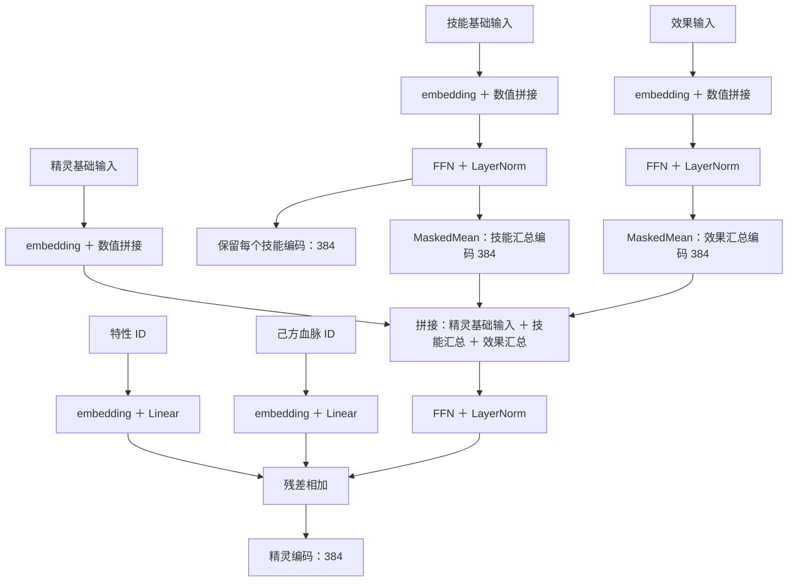
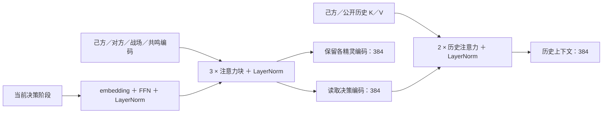
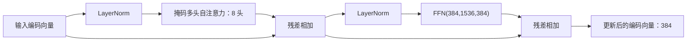
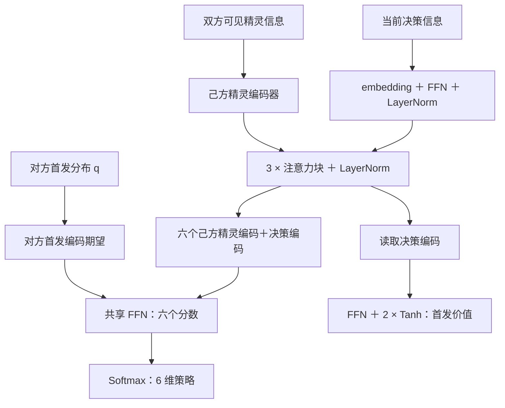
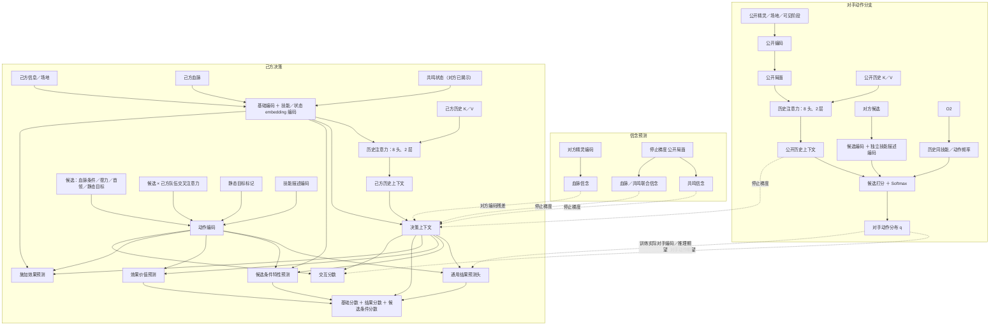

# Alpha Roco 模型设计

## 1. 网络结构

### 1.1 输入

| 输入组   | 内容                                                                                                                                                                                                                                                                                                                             |
| -------- | -------------------------------------------------------------------------------------------------------------------------------------------------------------------------------------------------------------------------------------------------------------------------------------------------------------------------------- |
| 己方状态 | 六只己方精灵的身份、属性、性格、特性 ID、特性战斗内状态、血脉、技能、效果及其来源方／来源精灵／来源特性／目标、精确数值、能量、出战位、技能槽与技能运行时状态                                                                                                                                                                    |
| 公共状态 | 双方身份与公开种族资料、对方队伍、生命百分比、已揭示技能及其使用历史、可见 buff／debuff 及其来源、印记、天气、公开战斗事件（序号、回合、阶段、类别、行动、效果、来源／目标实体与精灵／特性／技能 ID、数值、时长、层数、重放、分支）、公开行动、特性 ID、特性战斗内状态、应对事件、己方完整共鸣状态、对方已揭示共鸣状态与换人时机 |
| 候选动作 | 己方合法动作与对方公开候选；动作类型、施法精灵、技能、分支、派生特征、静态属性、效果描述与目标范围                                                                                                                                                                                                                               |
| 历史     | 每个决策的状态编码、动作编码与位置编码；己方历史与公开历史分开保存                                                                                                                                                                                                                                                               |
| 静态知识 | 种族、属性、特性、技能池、血脉技能、技能静态属性、技能效果描述与状态技能目标类型；由静态数据与技能定义构建词表与特征                                                                                                                                                                                                             |

- 数值归一化；未知值用掩码占位。
- 对方未公开的面板使用约束先验：在性格一升一降、六项个体值中三项 `10` 三项 `0` 的合法组合上求每项属性的均值；攻击、防御、魔攻、魔防、速度同时保留合法上下界；生命使用百分比。
- 己方血脉是输入；对方血脉不输入，由公开队伍、已揭示血脉技能、入场时机和历史推断，真实血脉作辅助标签。
- 共鸣魔法独立编码；对方种类未知，除非已使用，由公开队伍与行为推断；候选动作通过血脉条件连接两者。
- 特性触发事件、应对事件、特性目标标签和状态技能目标标签用于辅助监督。
- 静态数据用于四类用途：生成身份、种族、技能与效果输入特征；计算类型克制、伤害与速度先验；生成候选、血脉与目标掩码；生成特性和状态目标的辅助预测标签。策略动作只由真实对局回报学习，不用静态规则指定动作。
- 对手动作分支只读公共状态、公开历史、候选与静态知识。

#### 1.1.1 超参数

- 隐藏维度 `384`；当前局面注意力为 `8` 头、`3` 层，FFN 隐藏维度为 `4 × 384`；历史注意力为 `8` 头、`2` 层。
- 身份 embedding 为 `32` 维；类别、技能属性键、效果键、状态属性键 embedding 为 `16` 维；阶段编码与位置编码为 `384` 维；候选静态目标标记为 `6` 维。
- 注意力残差与 FFN 输出使用 dropout，比例 `0.1`；采样与推理关闭，更新时开启。

#### 1.1.2 可学习参数

- embedding 表、Linear／注意力权重与偏置、LayerNorm 缩放与偏移。
- 己方首发与战斗共享己方编码器；对手动作分支使用独立参数。
- 辅助预测头与策略／价值共享己方主干。

### 1.2 编码器

记号：`FFN(a,b,c) = Linear(a,b) → GELU → Linear(b,c)`；`MaskedMean` 对有效项求平均。

#### 1.2.1 精灵、技能与效果的基础编码

- 精灵信息：身份、主属性、副属性、性格、特性 ID、血脉 ID、数值或区间、掩码。
- 基础输入维度：精灵数值／掩码 共 `42` 维，技能数值 `14` 维，效果数值 `6` 维。
- 技能基础信息：身份、类别、属性、威力、能耗、应对类别、打断、传动、迅捷、蓄力、可用、明暗、掩码。
- 效果信息：类型、数值、时长、来源方、来源精灵、来源特性、来源类别、掩码；效果所属目标由持有该效果的精灵编码表示。
- 主属性与副属性分别编码；己方性格使用独立 embedding；对方不可见数值按个体值与性格范围推算为区间。
- 特性 ID 与己方血脉 ID 分别经独立投影后残差加入精灵编码；对方血脉不进入该编码。

#### 1.2.2 通用技能编码

攻击、防御、状态技能共用同一条技能描述编码路径。每个技能携带三类通用描述：

- 静态属性：类别、属性、威力、能耗、连击、吸血、减伤、先手、能耗修正、威力修正、传动、迅捷、蓄力、选择、可用、应对类别、打断、每回合替换、目标范围。
- 效果描述：效果类型、目标、触发阶段、数值、时长；嵌套效果递归展开。
- 技能状态属性：槽位传动、冷却与待冷却、使用计数、蓄力状态、临时替换、来源技能、成长值。

编码方式：

- 每条静态属性表示为 `(属性键 embedding, 数值投影)`；有效项经 FFN 后 `MaskedMean`。
- 每条效果描述表示为 `(效果类型 embedding, 目标 embedding, 阶段 embedding, 数值投影, 时长投影)`；有效项经 FFN 后用 8 头掩码注意力池化，查询编码可学习。
- 每条技能状态属性表示为 `(状态键 embedding, 数值投影)`；按技能槽求 `MaskedMean`。
- 静态属性池与效果池拼接后投影为 `384` 维，残差加入该技能的基础编码；技能状态属性按槽位残差加入。
- 机制扩展通过属性键、效果类型或状态键表达；编码层与注意力层不随机制数量改变。
- 技能描述编码同时用于己方技能、己方候选与对手候选；对手分支使用独立参数。

#### 1.2.3 候选动作

- 候选张量包含动作类型、施法精灵、技能、明暗分支、分支编号、威力、能耗、技能槽位与 `27` 维派生特征。
- 派生特征包含技能克制、本系加成、预计伤害、击杀回合、先手、剩余能量、可支付、应对类别、打断、传动、迅捷、蓄力、可用；换人候选包含入场攻防克制、生命与速度；另有动作类型和血脉／愿力／首领条件。
- 候选携带 `6` 维静态目标标记：自身、敌方、己方场下、己方队伍、敌方队伍、双方在场。
- 候选编码器使用动作 embedding、技能 embedding、数值投影与派生特征投影，输出 `384` 维；共鸣魔法 ID 经独立 embedding 残差加入候选编码。
- 技能候选读取该技能槽的完整技能编码；换人与聚能读取零技能编码。
- 候选编码加入己方队伍均值、候选与己方六只精灵的交叉注意力，以及静态目标标记投影。
- 对手候选使用候选编码与对手分支的独立技能描述编码；技能槽运行时状态按当前可见字段读取。

#### 1.2.4 通用状态编码

- 精灵状态属性：生命比例、能量、减伤、冷却与待冷却数量、蓄力、迸发、使用计数、上次使用技能、应对统计、入场后行动、入场回合、光合治愈、超载、离场次数、上次与上上次技能属性／类别、buff 数量与时长、特性内部计数与就绪状态。
- 技能使用历史按精灵编码：每次使用的回合、技能 ID 与重放标记；按时间顺序经掩码注意力池化后加入精灵编码。
- 每条状态属性表示为 `(状态键 embedding, 数值投影)`，经 FFN 与 `MaskedMean` 池化为 `384` 维，残差加入精灵编码。
- 技能槽状态属性按 `(状态键 embedding, 数值投影)` 编码，残差加入对应技能编码。
- 状态属性只使用当前可见字段；对方未公开字段的掩码为否。
- 状态扩展通过状态键或序列化字段表达；网络层与预测头不随状态类型改变。

#### 1.2.5 局面与历史

| 输入         | 编码内容                                                                                 |
| ------------ | ---------------------------------------------------------------------------------------- |
| 当前决策信息 | 阶段编码                                                                                 |
| 精灵信息     | 己方六只、对方六只的精灵编码                                                             |
| 共鸣状态     | 己方与对方各 `8` 维；己方完整共鸣魔法 ID、使用次数、冷却、剩余次数，对方仅编码已揭示状态 |
| 战场状态项   | 天气、双方印记、魔力／共鸣、回合；每项 `5` 维                                            |
| 历史         | 当前决策前保存的己方历史 K／V 与公开历史 K／V                                            |

- 己方、对方、战场项和共鸣项进入 `3` 层注意力，读取当前局面编码；己方历史与公开历史分别使用独立的 `2` 层历史注意力。

结构化战斗事件：

- 每条事件编码类别、阶段、行动与效果的 embedding，来源／目标实体的种类 embedding、精灵 ID 与特性 ID embedding，事件技能 ID 与特性 ID embedding，以及回合、序号、顺序、数值、层数、时长、技能槽、重放、选择分支、公开标记、相对阵营、精灵下标与存在标记等数值。
- 事件编码经块内与块间两段注意力：按 `64` 条分块，块内复用事件自注意力；块内有效事件经 masked mean 得到块摘要，块摘要再经独立注意力得到块间上下文，块间上下文经零初始化投影残差加回每个事件 token。padding 不计入块摘要，尾块不足 `64` 条时按实际有效事件处理。
- 事件 token 与双方十二只精灵编码做交叉注意力，来源／目标为宠物时分别从对应精灵编码取值，无有效实体时取零向量。
- 事件摘要经零初始化投影残差加入局面编码；主策略读取全部事件（含私有），对手公开分支只读取公开事件。
- 事件按发生顺序排列；事件流只保留最近 `2048` 条，超出时淘汰最久未被引用的宠物、技能或特性相关事件，同久时淘汰序号较小者；编码器读取保留后的事件。
- 历史编码：
  $$
  K_i=\operatorname{LayerNorm}(s_i+a_i+p_i),\qquad
  V_i=\operatorname{LayerNorm}(s_i+a_i)
  $$
  $s_i$ 为状态编码，$a_i$ 为动作编码，$p_i$ 为位置编码；当前决策状态加位置编码作为查询；全部历史 K／V 参与注意力；使用因果掩码与填充掩码。

#### 1.2.6 对手公开编码

- 对手动作分支读取双方公开精灵、公开战斗事件、战场项、双方共鸣状态、公开历史和历史候选频率。
- 公开精灵编码包含身份、主副属性、特性 ID、生命百分比、已揭示配招、技能使用历史与可见数值，不包含己方精确面板或未揭示信息；技能 ID 通过对方候选池进入候选编码，候选池由公开种族技能与已揭示技能构成。
- 公开战斗事件使用与主策略相同的结构化字段，只保留公开事件；事件相对阵营按己方在前、对方在后的公开精灵顺序映射到精灵编码。事件编码经注意力池化后，与对方每只精灵编码做交叉注意力，更新对方精灵编码和公开局面编码。
- 对手动作分支不读取操作习惯输入。
- 公开历史注意力、更新后的对方精灵编码与候选频率用于对手候选打分；输出对手动作分布 $q$。

### 1.3 注意力块

结构化事件的块内与块间注意力、首发、己方战斗局面、对手公开局面各使用 `3` 个下列注意力块，输出接 LayerNorm；各分支参数独立。

### 1.4 首发模块

- 对手动作分支输出对方六个首发候选的分布 $q$；按 $q$ 聚合对方首发候选编码，加入己方首发分数。真实对方首发作辅助标签。
- 首发价值附带首个战斗状态势能的辅助预测。

### 1.5 战斗模块

战斗模块包含六条信息流：

1. **己方局面与历史**：己方可见信息经过基础编码、技能／状态 embedding 编码与 `3` 层注意力，得到当前局面；己方历史 K／V 经过 `2` 层历史注意力，得到己方历史上下文。
2. **对手动作**：只读公共状态、公开历史与历史候选频率，输出对手动作分布 $q$。
3. **己方决策**：当前局面、己方历史与停止梯度公开历史组成上下文。己方血脉编码与共鸣状态独立编码。候选读取队伍均值、候选与己方六只精灵的交叉注意力、静态目标类型、技能描述、分支、派生特征与血脉条件：愿力元素由血脉派生，首领血脉禁用；首领化要求首领血脉和分支；光合治愈无血脉条件。
4. **通用结果预测**：每个候选预测十二只精灵的结果属性变化与目标分布。训练时对手输入取实际对手候选编码，推理时取对手动作分布期望。
5. **候选条件预测**：每个候选预测其触发的特性、特性作用目标，以及效果效用分量的变化；前两项逐精灵给出，后一项逐候选给出。
6. **施加效果预测**：每个候选预测本步施加的效果类型（己方／敌方两侧）与目标精灵，不参与候选打分。

对手信念预测：

- 血脉信念：从对方精灵编码输出每只对方精灵的血脉分布，已揭示血脉技能收窄候选集合。
- 共鸣信念：从停止梯度公开局面输出对方共鸣魔法分布；只有已使用状态作为输入。
- 联合信念：从停止梯度公开局面输出对方在场血脉与共鸣魔法的联合分布。
- 三个信念通过 embedding 加入己方决策上下文；真实值只作辅助标签。

### 1.6 评分与价值

- 基础分数：战斗上下文与候选编码拼接后经 FFN；通用结果分数、候选条件特性触发分数与效果价值分数分别经零初始化投影加入基础分数。
- 结果分数训练时读取实际对手候选编码，推理时读取对手动作分布期望。
- 交互分数：候选编码、对手候选编码与战斗上下文三元组经 FFN；按对手动作分布 $q$ 加权求和。
- 合法候选 Softmax；非法候选填充 $-\infty$。
- 价值：战斗上下文经 FFN 后 `2 × tanh`；首发价值只读首发局面。
- 搜索接口保留 `logits` / `base_logits` / `interactions` / `value` 输出键。

### 1.7 通用结果预测

结果预测头对每个候选、每只精灵预测一组通用结果属性：

- 输入：候选编码、十二只精灵编码、战斗上下文、对手编码；训练时对手编码取实际对手候选，推理时取对手动作分布期望。
- 对每个 `(候选, 精灵)` 拼接三者，经 FFN 得到结果隐藏编码。
- 结果属性增量由结果隐藏编码与属性键 embedding 的点积给出；属性键覆盖生命、能量、减伤、冷却、蓄力、迸发、使用计数、应对统计、入场状态、技能属性／类别与 buff 状态等。
- 目标分布由结果隐藏编码输出十二只精灵的目标 logit。
- 结果增量展开后经零初始化分数头加入基础分数。
- 监督：相邻 A 决策之间的真实状态差；选中候选的目标掩码来自技能静态目标（攻击／防御默认敌方在场，状态技能按静态目标）；未选中候选共享参数泛化。
- 结果预测覆盖所有可观察状态差与目标变化，共用同一预测头。

### 1.8 辅助预测

- 对手动作分支的标签来自对手实际行为：采样局使用实际采样分布（`softmax`），非采样局使用 argmax 实际动作的 one-hot；分布按 `action_key` 映射到公开候选池，未映射概率丢弃后重新归一化，可映射总概率低于 `0.5` 时回退实际动作 one-hot。replacement 阶段不使用分布标签。
- 有分布的样本使用软交叉熵 $-\sum p \log q$，无分布样本使用实际动作的硬交叉熵；无效候选的分布置零并重新归一化，`log_softmax` 后对无效位置置零，避免 `0 \times -\infty`。
- 血脉、共鸣、联合信念使用真实值与已揭示技能约束。
- 首发价值使用首个战斗状态势能。
- 结果预测头使用通用结果属性损失与目标分布损失。
- 候选条件特性触发：对选中候选，以十二只精灵的特性触发标签做 BCE。
- 候选条件特性目标：对已触发的源，把其十二只精灵的目标并集归一化作为分布，对选中候选做 BCE；没有触发时跳过目标损失。
- 效果价值：对选中候选预测下一步效果效用分量的变化，目标为下一步效果价值减当前效果价值，终局下一步记 `0`，做 MSE。
- 施加效果：只统计由本步行动施加的效果（来源方为己方且来源类型为空），按相邻 A 决策间同一（精灵、效果、来源）的累计层数增量判定，己方与敌方两侧分别做多标签 BCE；归属精灵可解析时对十二只精灵的目标掩码做 BCE，不可解析时只监督类型。记录类型维度的准确率、正例查准及其零基线。
- 辅助头按监督对象分三档系数：效果差、效果价值、施加效果、特性触发／目标／作用、候选条件特性触发／目标、逐精灵影响、状态技能目标为 `0.3`；伤害／击杀、逐精灵状态变化、候选级逐精灵影响、通用结果、对方血脉、对方共鸣、血脉与共鸣联合、首发后势能为 `0.1`。
- 每个辅助头同时记录全零预测的基线损失，用于判断该头是否优于平凡预测。
- 所有辅助损失指标与零基线写入 `metrics.jsonl`。

## 2. 奖励

### 2.1 终局

- 胜 `+1`，负 `-1`，双方失败 `-1`。
- 终局奖励只赋给最后一条战斗记录；首发记录携带首发奖励。

### 2.2 势能

势能由六个归一化分量组成，每项取值在 `[-1, 1]`：

$$
\begin{aligned}
c_{hp} &= 敌方生命比例 - 己方生命比例 \\
c_{alive} &= \frac{己方存活 - 敌方存活}{6} \\
c_{magic} &= \operatorname{clip}\left(\frac{己方魔力 - 敌方魔力}{4}, -1, 1\right) \\
c_{energy} &= \tanh\left(\frac{己方能量 - 敌方能量}{10}\right) \\
c_{effect} &= \tanh\left(\frac{己方效果价值 - 敌方效果价值}{2}\right) \\
c_{mark} &= \tanh\left(\frac{己方印记价值 - 敌方印记价值}{5}\right)
\end{aligned}
$$

$$
\Phi = \text{feedback\_scale} \times \frac{c_{hp} + c_{alive} + c_{magic} + c_{energy} + c_{effect} + c_{mark}}{6}
$$

- 效果价值按每条增益／减益的 `tanh(|数值| / 2)`、符号与时长累计；敌方减益在己方视角为正。
- 印记价值按正／负印记层数与所属方累计；敌方负印记在己方视角为正。
- 六个分量等权，避免生命项因原始尺度大而压过状态、印记、能量与魔力。
- 每条战斗记录的奖励为下一状态势能减当前势能，折扣因子 `1.0`；状态效果在下一状态立即进入势能反馈。
- 本次行动实际造成的增益／减益／印记增量另给直接奖励，系数 `effect_event_reward=0.05`，避免延迟收益只通过未来势能传播。

### 2.3 行为先验

- 首发一击击杀与首发不被一击击杀给予小奖励。
- 第一回合主动换人、连续主动换人、重复无进展给予惩罚。
- 探索阶段对未使用技能、状态技能与首次触发特性给予奖励；状态技能探索权重为 `1.0`，后续阶段为 `0.3`；探索奖励不设单局上限。

### 2.4 组合

- 奖励由终局、势能、行为先验与探索奖励相加。
- 探索奖励不替代终局奖励。

## 3. 训练目标

### 3.1 PPO

- 候选方固定为 A，B 为冻结的当前 best 或 best 池中的历史快照。
- 学生模型从随机初始化或已有 checkpoint 的参数开始；热启动只继承模型参数，不继承优化器、RNG、批次与 best 池。
- 每批真实对局按 GAE 计算优势，按候选动作做 PPO 裁剪更新。
- 价值目标为回报，价值输出限制在 `[-2, 2]`。
- 对手动作分支使用独立优化器，不接收策略梯度。

### 3.2 教师模型蒸馏

- 指定教师时，教师为冻结模型，通常取初始 best；学生从随机初始化或热启动参数开始。
- 每个训练步骤同时前向教师模型；教师模型维护自己的己方／公开历史 K／V。
- 在合法候选上计算教师模型分布与学生模型分布的 KL，加入策略损失。
- 学生模型首次晋升表示已超过初始 best；晋升后关闭教师模型蒸馏，初始 best 进入 best 池，训练回到 checkpoint、best 与 best 池的循环。
- 未指定教师时不启用蒸馏。
- 教师模型不更新参数，不继承教师模型的优化器、RNG、批次或 best 池。

### 3.3 结果与状态监督

- 通用结果属性损失：选中候选的十二只精灵属性差，按真实状态差做掩码 MSE；训练时对手输入取实际对手候选编码，推理时取对手动作分布期望。
- 通用目标分布损失：选中候选的目标 logit，按技能静态目标做 BCE。
- 结果增量与目标分布只监督选中候选；未选中候选通过共享参数泛化。
- 施加效果损失：选中候选的效果类型多标签 BCE 与目标掩码 BCE；标签只含本步行动施加、按累计层数增量判定，归属精灵不可解析时只监督类型。
- 效果差、效果价值、施加效果、特性触发／目标／作用、候选条件特性触发／目标、状态技能目标辅助损失以 `0.3` 参与；伤害／击杀、逐精灵状态变化、候选级逐精灵影响、通用结果、对方血脉、对方共鸣、联合信念、首发后势能以 `0.1` 参与。
- 全部辅助损失及其零基线写入训练指标记录。

### 3.4 单步搜索

- 搜索使用对手动作分布 $q$ 与交互分数期望。
- 对 top-k 对手候选取最坏交互分数，按风险系数混合。
- 搜索不改变训练损失。

### 3.5 参数与 checkpoint

- checkpoint 保存 `model_schema_version`、`feature_schema_version`、`state_schema_version`、模型配置、训练配置、词表、模型参数、优化器、RNG、批次与 best 信息。
- `--resume` 恢复同一 schema 的完整训练状态；`--warm-start` 只加载学生模型参数，优化器、RNG、批次与 best 池重新开始。
- `--champion` 指定初始擂主，只作为评测参照与采样对手，不参与训练；擂主与学生初始化相互独立。
- `--teacher` 加载冻结教师模型，只用于首次晋升前的蒸馏，不影响擂主。
- 初始 best 的来源顺序：输出目录已有 best.pt → `--champion` → 热启动模型 → 学生模型的副本。

### 3.6 对手池与晋升

- 每局对手以概率 `0.5` 取当前 best，其余从 best 池按胜率加权采样：池内胜率落在 `0.2`–`0.8` 的权重为 `1`，其余为 `0.2`。
- 按固定间隔评测：候选与当前 best 在固定种子下对局 `400` 局，相对胜率超过 `0.55` 才晋升。
- 晋升时旧 best 存为池快照，best 更新为候选；未晋升的评测批次把当前模型存为池快照，使对手持续更新；池超过 `8` 个快照时淘汰最早的。
- Elo 按 `best_elo + 32 × (胜率 − 0.5)` 累计，仅用于记录。
- 池快照与 `best.pt` 一同构成后续批次的对手来源。
