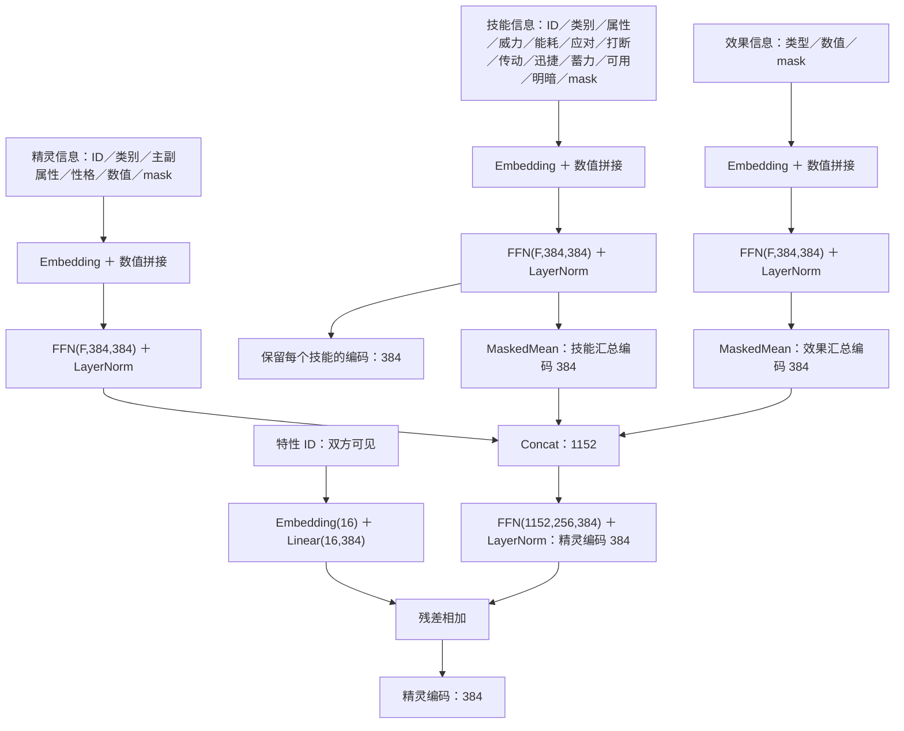
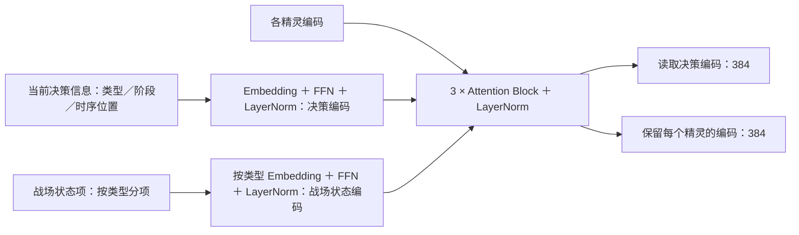
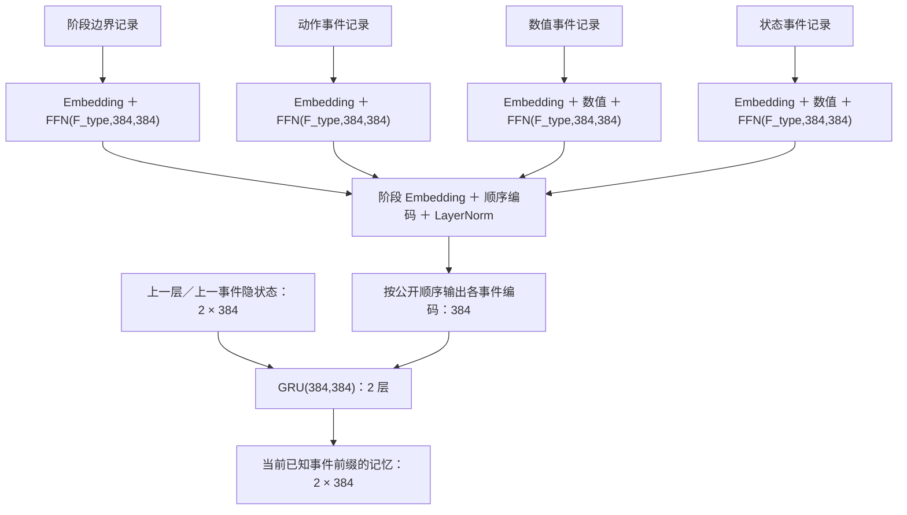
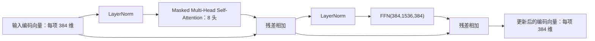
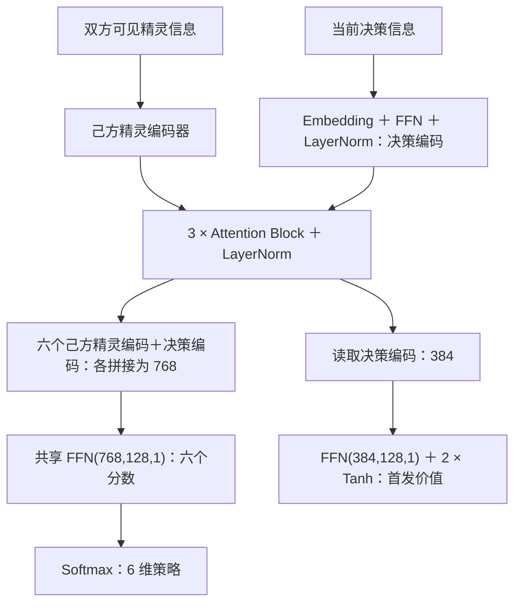
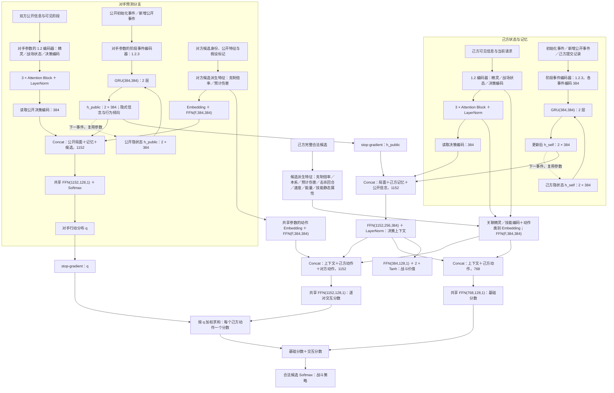
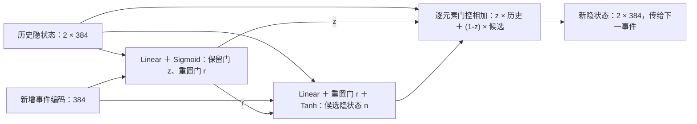

# Alpha Roco 模型设计

## 1. 网络结构

### 1.1 基本配置

#### 1.1.1 输入

- 可见特征、可见性掩码、有序事件及候选动作；数值归一化，未知值使用占位符。
- 派生特征：属性克制倍率、本系加成、预计伤害占比、预计击杀回合、速度先后、能量是否足够、技能静态属性。
- 精灵特性 ID 作为输入，双方可见。
- 对手预测分支仅接收公开信息。

#### 1.1.2 超参数

- 隐藏维度 `384`；Attention 为 `8` 头、`3` 层，FFN 隐藏维度为 `4 × 384`；两路记忆各使用 2 层 `GRU(384,384)`。
- 身份／类别／特性 Embedding 为 `32／16／16` 维，阶段／顺序编码为 `384` 维。
- Attention 残差与 FFN 输出使用 dropout，比例 `0.1`；采样与推理关闭，更新时开启。
- 训练超参数见第 3 节。

#### 1.1.3 可学习参数

- Embedding 表、Linear／Attention／GRU 的权重与偏置、LayerNorm 的缩放与偏移。
- 首发与战斗共享己方精灵编码器参数；对手分支参数独立。

#### 1.1.4 环境

- 设备：RTX 4080 SUPER（16 GB）。
- 时限：单次决策上限 `20` 秒。

### 1.2 输入信息与编码器

输入使用具体的信息名称；网络输出称为对应的编码向量，图中简写为“精灵编码：384”等，数字表示维度。

记号：`FFN(a,b,c) = Linear(a,b) → GELU → Linear(b,c)`；`F` 为输入维度；`MaskedMean` 对有效项求平均。

#### 1.2.1 精灵、技能与效果编码

- 精灵信息：身份、类别、主属性、副属性、性格、特性 ID、数值或区间、mask。
- 技能信息：身份、类别、属性、威力、能耗、应对类别、打断、传动、迅捷、蓄力、可用、明暗、mask。
- 效果信息：类型、数值、mask。

- 主属性与副属性分别编码；己方性格使用独立 Embedding；对方不可见数值按个体值与性格范围推算为区间输入。
- 特性 ID 使用独立 Embedding，经投影后以残差方式加到精灵编码；双方特性都编码。

#### 1.2.2 战场状态与决策编码

| 输入 | 编码内容 |
|---|---|
| 当前决策信息 `DECISION` | 决策类型、阶段、时序位置与参与方 |
| 精灵信息 | 身份、类别、主副属性、性格、特性 ID、数值或区间、关联技能／效果与可见性掩码 |
| 战场状态项 | 状态类型、所属方、数值与可见性掩码；每项独立编码 |

- 各类型使用 `Embedding＋FFN(F_type,384,384)＋LayerNorm`；Attention 读取更新后的决策编码向量，并保留每个精灵的编码向量。

#### 1.2.3 阶段事件编码

- 事件记录：类型、阶段／实例／父阶段、关联动作、来源／目标、顺序、数值与可见性。
- 每条事件独立编码，包含阶段边界；同类事件跨阶段共享 FFN。
- 事件编码向量：`LayerNorm(FFN_type(事件字段编码)＋阶段 Embedding＋顺序编码)`，维度 `384`；按已知前缀送入 GRU。

### 1.3 Attention Block

首发、己方战斗局面、对手公开局面各使用 `3` 个下列 Block，输出接 LayerNorm；各分支分别设置 Block 参数。

### 1.4 首发模块

### 1.5 战斗模块

- 两路 2 层 GRU 分别编码己方可见历史和公共历史，后者形成隐式信念与行为倾向表示。
- 战斗阶段的可选动作由技能、聚能、换人组成；对方候选由同一动作集合生成。
- 技能候选包含动作类别、精灵、技能、明暗分支、威力、能耗、使用后能量、是否可支付、相对对方当前精灵的属性克制倍率、本系加成、预计伤害占对方当前 HP 比例、预计击杀回合、速度先后，以及应对类别、打断、传动、迅捷、蓄力、可用标记；聚能候选的派生特征取中性值。
- 换人候选额外包含入场精灵对对方当前精灵的进攻与防守克制关系；对方候选包含其技能相对我方当前精灵的克制倍率与预计伤害。
- 对手分支对候选动作输出概率；决策分支融合状态、记忆与信念，输出基础分数及按对手概率加权的动作交互分数。

### 1.6 时间连接

- 两路 2 层 GRU 独立参数、时间共享；隐状态按 episode 清零，按新增事件更新并去重，在决策点读取。
- $h_k=z_k\odot h_{k-1}+(1-z_k)\odot n_k$，$z_k$ 为保留门，$n_k$ 为候选隐状态。

## 2. 奖励

- 终局收益：获胜 `+1`，失败 `-1`，`both_lose` 双方 `-1`。
- 战斗决策的过程收益按势能差计算：
  $$
  \Phi(s)=0.5\left(H_{\text{对方}}-H_{\text{己方}}\right)+0.1\frac{N_{\text{对方}}-N_{\text{己方}}}{6}+0.02E,\qquad
  r_t=\gamma\Phi(s_{t+1})-\Phi(s_t)
  $$
  $H$ 为队伍平均剩余血量比例，$N$ 为存活数；$E$ 为双方有效增益/减益层数差（按10层归一化并截断到±2，特性产生的持续效果计入）；终局 $\Phi=0$。
- 首发奖励：首发精灵可一击击杀对方首发时 `+0.05`；对方首发不能一击击杀己方首发时 `+0.05`；两项可叠加。
- 主动换人惩罚：第一回合主动换人 `-0.05`；连续两个主动行动均为换人时，后一次 `-0.1`；补位与强制换人不计。
- 技能探索：candidate A选择 category 2／3 技能时，按 `1/(1+累计次数)` 获得技能探索奖励，系数 `0.02`，category 3 权重 `1.2`，单局上限 `0.10`；`rare_skill_batches=0` 表示全程。
- 特性探索：按 trait ID 统计触发次数，首次／低频触发给 `0.05/(1+次数)`。
- 奖励由终局收益、势能、探索奖励、换人惩罚和首发奖励组成。
- 首发决策使用终局收益；战斗决策使用过程收益，最后一个战斗决策同时使用终局收益。$\gamma=1$。
- 训练时candidate固定A侧，只记录A侧首发与战斗决策及收益；对手B侧不更新。终局停止自举。

## 3. Loss 与更新

### 3.1 己方首发与战斗

分别计算 $k\in\{L,B\}$ 的 PPO 策略 loss：

$$
L_{\pi,k}=-\mathbb E\left[\min\left(\rho_k\hat A_k,\operatorname{clip}(\rho_k,1-\epsilon,1+\epsilon)\hat A_k\right)\right],\qquad
\rho_k=\frac{\pi_k(a\mid o,h)}{\pi_{k,\mathrm{old}}(a\mid o,h)}
$$

$$
L_{\mathrm{RL}}=\sum_{k\in\{L,B\}}\left(L_{\pi,k}+0.5\,\mathbb E[(V_k-\hat G_k)^2]-\beta_k\mathbb E[H(\pi_k)]\right)
$$

- 辅助头与策略／价值共享主干，按目标分组：
  - `damage`：预测造成／承受伤害比例，MSE。
  - `ko`：预测双方击倒，BCE。
  - `state_change`：预测 buff／debuff／印记／能量维度是否变化，按维度变化频率计算正例权重、上限 `10` 的 BCE。
  - `effect_delta`：预测上述维度的具体变化，非零维度按频率加权 masked MSE；来源为选中技能动作。
  - `trait_trigger`：预测当前队伍中存在的 trait 是否在区间内触发，BCE；标签来自 `trait_events`。
  - `trait_effect`：预测 trait 触发后的效果差，非零维度按频率加权 masked MSE；与 `effect_delta` 共用输出头，来源为触发的 trait embedding。
- `damage`、`ko`、`state_change`、`effect_delta`、`trait_trigger`、`trait_effect` 分别记录损失和零预测基线；最后一个战斗决策不计辅助损失。
- 总损失 $L=L_{\mathrm{RL}}+0.1L_{\mathrm{damage}}+0.1L_{\mathrm{ko}}+0.1L_{\mathrm{state\_change}}+0.1L_{\mathrm{effect\_delta}}+0.1L_{\mathrm{trait\_trigger}}+0.1L_{\mathrm{trait\_effect}}$。
- 首发使用 $\hat G_L=z$、$\hat A_L=z-V_{L,\mathrm{old}}$；战斗使用 GAE，$\hat G_B=\hat A_B+V_{B,\mathrm{old}}$。
- 各阶段分别平均 loss、标准化策略优势；回报目标与价值目标保持原始尺度。
- 初始设置：$\epsilon=0.2$、GAE $\lambda=0.95$、$\beta_L=\beta_B=0.03$，damage／ko／state_change／effect_delta／trait_trigger／trait_effect 系数均为 `0.1`，Adam 学习率 `5e-5`，梯度范数上限 `0.5`。
- PPO 按有序对局重算己方循环状态；累计策略 KL 达 `0.02` 时结束该批策略更新。

### 3.2 对手预测

$$
L_{\mathrm{opp}}=-\mathbb E[\log q_\phi(a^{\mathrm{opp}}\mid I)]
$$

- $I$ 为决策前的公开信息历史，监督标签为对方实际提交行动；训练样本使用可确认标签。
- 交叉熵更新对手编码器、公开 GRU 与候选评分器，信念与习惯通过该目标学习。
- 对手分支使用独立 Adam，初始学习率 `1e-4`，梯度范数上限 `0.5`。

### 3.3 训练组织

- 模型、PPO、奖励、采样、评测与预训练超参数集中在 `alpha_roco/config.py`。
- 单个网络控制A、B双方，部署时两侧共享参数。训练时candidate固定为A侧并按策略采样，对手B侧为冻结模型并按argmax行动；每局双方从team0至team23随机选队。
- 对手从当前best与best池中采样：当前best占一半对局，池内按candidate对其胜率加权，优先20%–80%区间。晋升时旧best写入池，池保留最近`pool_size`个快照，胜率统计写入`pool_stats.json`。
- 每批采`games_per_batch=56`局真实terminal对局，采样按`sample_workers=16`并行，仅candidate A侧决策记入episode并计算终局收益；对手B侧只提供实际动作和预测标签。每批用candidate episode更新PPO策略／价值与辅助预测头，更新策略时冻结对手分支；再用对手动作标签更新对手交叉熵分支，更新时冻结策略／价值。默认2个PPO epoch。
- PPO按`update_chunk=16`局分块、按决策步并行重放循环状态并累积梯度；采样时模型处于eval，更新时处于train，dropout只在更新前向中生效；观察只用决策前可见信息；同组对手行动只作可确认候选的事后监督，补位不监督。
- 每个战斗决策记录势能、队伍血量、存活数、效果层数、印记和能量；相邻决策生成伤害／击倒和状态差辅助标签。`trait_events` 在相邻 A 决策之间切分，生成 trait 触发多标签。
- 每`eval_interval=8`批（448局训练）及最后一批对冻结best做完整评测：candidate A对best B，`eval_games=256`局、`eval_workers=32`并行，双方随机队伍。记录胜率与95% Wilson区间；胜率超过`promotion_threshold=0.55`时candidate晋升best，旧best进入池。Elo按单侧记录。评测记录写入`eval.jsonl`并生成`eval_table.md`。
- Checkpoint保存单模型、policy/opponent优化器、模型与训练配置、词表签名、best批次与单侧Elo、Python/PyTorch RNG。缺少 trait/aux 参数的旧格式加载旧权重后，新参数独立初始化，优化器状态重新建立。`metrics.jsonl`逐批保存训练指标（熵、KL、价值损失、damage／ko／state_change／effect_delta／trait_trigger／trait_effect 损失及零基线、对手交叉熵、`both_lose`率、状态动作率、不同技能数、不同状态技能数、不同效果数与 trait 触发次数），评估批次另记胜率、晋升状态与参考批次。

### 3.4 单步矩阵搜索

- 动作阶段使用基础分数 $B(a)$、交互矩阵 $I(a,b)$ 与对手分布 $q(b)$。取 $q$ 最高的 $k$ 个对手候选 $B_k$，候选 $a$ 的搜索分数为
  $$
  S(a)=B(a)+(1-\lambda)\sum_b q(b)I(a,b)+\lambda\min_{b\in B_k}I(a,b)
  $$
- 对 $S(a)$ 做合法候选 softmax；默认 $k=5$、$\lambda=0.5$。
- 首发与补位不搜索；搜索不调用环境状态转移或价值网络。
- 评测通过 `evaluate.py --search` 启用，训练采样仍使用原始 logits。

### 3.5 行为克隆初始化

- 规则 teacher 按克制倍率、预计伤害、速度、能量、对方上次行动类别、当前危险程度与后备预计伤害选择候选动作；对方行动类别匹配时优先应对，当前可击杀且先手时优先攻击；换人仅在危险、技能被抵抗或后备伤害明显更高时参与评分。teacher 确定性地在合法候选中取最高分。
- teacher 控制双方生成真实 terminal 对局；每个决策记录编码输入与 teacher 选中的候选索引。
- 按 side 的 episode 顺序重放循环状态，对策略 logits 做交叉熵，更新策略参数，不更新对手分支。
- 默认收集 `games=256` 局、每块 `64` 局、2 个 epoch；保存 `pretrain.pt`，训练通过 `--resume` 接续。
